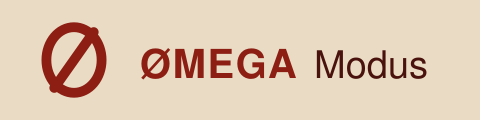
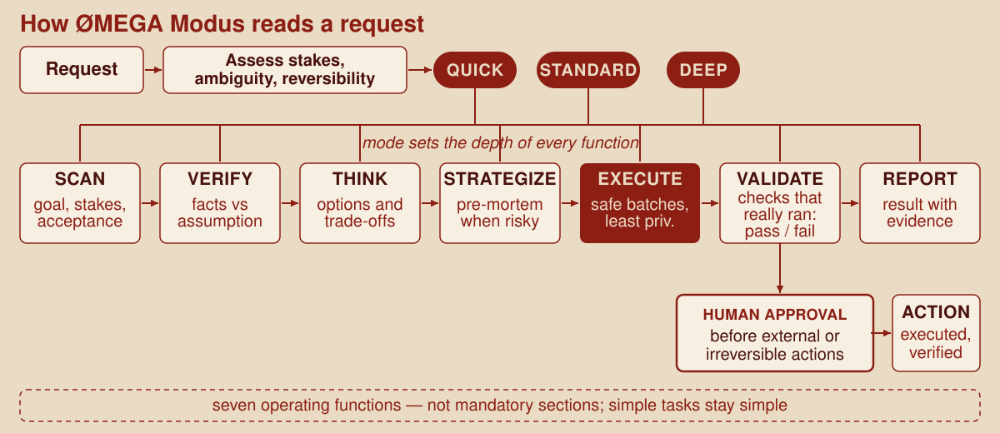
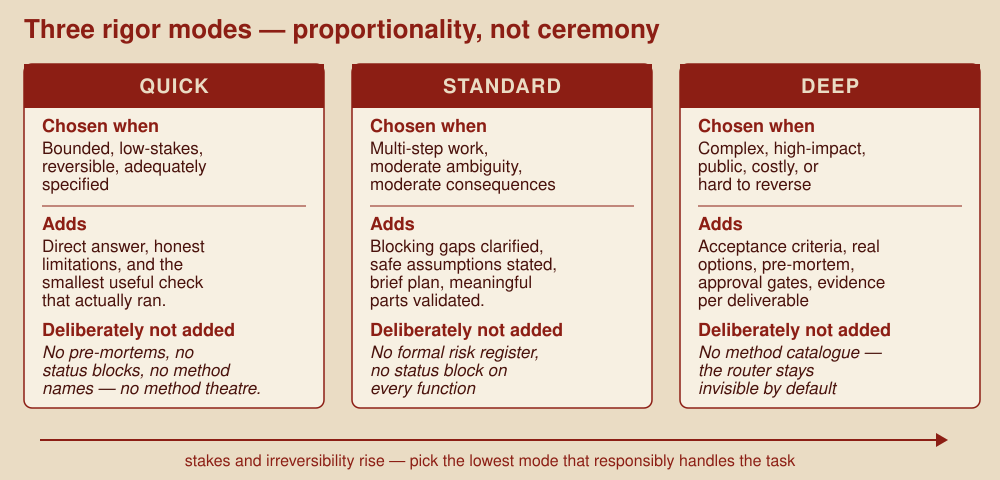
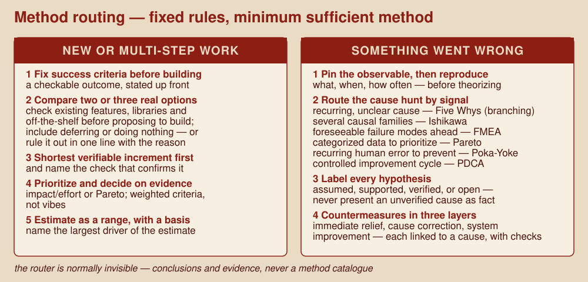
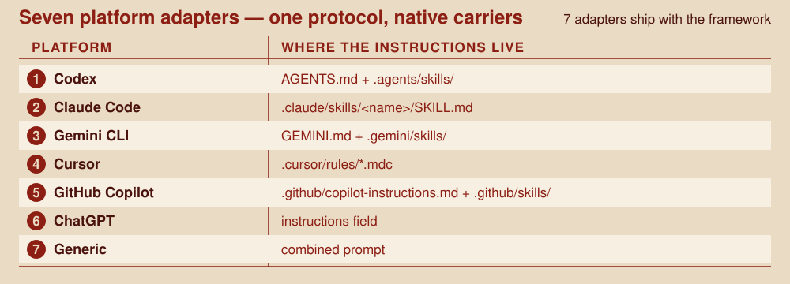

<p align="center">
  <picture>
    <source media="(prefers-color-scheme: dark)" srcset="assets/logo-horizontal-dark.svg">
    
  </picture>
</p>

# ØMEGA Modus

**An instruction framework that decides how much care a task deserves — and refuses to claim what it did not verify.**

[](LICENSE)
[](docs/PLATFORM_COMPATIBILITY.md)
[](pyproject.toml)
[](https://github.com/MichaelS1011/0mega-Modus/actions/workflows/validate.yml)

A capable model already knows how to work carefully. What it does not reliably do on its own is judge how much care a task needs, refuse to invent a test result, and stop before an irreversible action. ØMEGA Modus is a ruleset — a skill and an `AGENTS.md` — that adds exactly those three behaviours. Nothing else.

It is not a model, not an agent runtime, not a security boundary, and not a guarantee of correctness. It cannot enforce anything the host environment does not enforce itself.

## How it works

<p align="center">
  
</p>

Before working, the agent fixes a rigor mode. The seven functions are operating functions, not mandatory headings — a QUICK answer stays three lines long.

| Function | What it does |
|---|---|
| **SCAN** | Goal, constraints, stakes, ambiguity, acceptance criteria |
| **VERIFY** | Separate what is known, inferred and assumed |
| **THINK** | Options and their trade-offs, including one counter-explanation |
| **STRATEGIZE** | Route to a fitting method by fixed signal rules, or to none |
| **EXECUTE** | Smallest reversible step that moves the task forward |
| **VALIDATE** | Check against the acceptance criteria; executed, not proposed |
| **REPORT** | Result, evidence, what is still open |

## See it in 36 seconds

An unverified claim gets cross-checked, the ASK/CHECK/REFUSE rules appear, a real test run turns green, and the clone command closes the clip.


## Three rigor modes

<p align="center">
  
</p>

| Mode | Chosen when | Adds | Deliberately does not add |
|---|---|---|---|
| **QUICK** | Reversible, low stakes, narrow scope | Direct answer, visible assumptions | Sections, method names, checklists |
| **STANDARD** | Normal engineering and writing work | Options, acceptance criteria, real checks | Full method apparatus |
| **DEEP** | Irreversible, external effect, high cost of being wrong | Root-cause and failure analysis, approval gates | Ceremony that produces no evidence |

Over-processing a simple task is a failure, not extra diligence. The project calls it *method theatre*.

## Methods by signal, not by habit

<p align="center">
  
</p>

Fixed rules decide when a method applies — the agent neither picks arbitrarily nor shows a catalogue. Planning work fixes acceptance criteria up front, compares genuinely different options including reuse, buy, defer and do-nothing, starts from the shortest verifiable increment, and gives effort as a range with a stated basis. Failure work reproduces the problem first, routes the cause hunt by signal (Five Whys, Ishikawa, FMEA, Pareto, Poka-Yoke, PDCA), labels every hypothesis as assumed, supported, verified or open, and ends with countermeasures on three layers. The method names stay out of the answer; what is visible are conclusions and evidence.

## Install

```bash
git clone https://github.com/MichaelS1011/0mega-Modus.git
cd 0mega-Modus
python scripts/build_release.py
```

Then pick **one** adapter in [docs/INSTALLATION.md](docs/INSTALLATION.md) and copy the generated bundle from `dist/omega-modus-v1.1.0/bundles/` into that platform's configuration location. Start a new session so the instructions load.

The tooling is standard-library Python 3.10+, no dependencies, no binaries. Repository checks:

```bash
python scripts/validate_release.py
python -m unittest discover -s tests
```

## Try it in 60 seconds

Ask your assistant:

> Compare two ways to organise my weekly tasks. Keep it simple, state your assumptions, recommend one, give me a first step.

Correct behaviour: a short answer, no workflow theatre, assumptions visible, nothing invented. Then:

> We keep missing a release deadline. Find the cause, propose a prevention measure, define how we verify it worked. Do not assume the cause before examining the evidence.

Correct behaviour: symptoms separated from verified causes, one fitting method instead of all of them, a measurable check, and no claimed test that was not run.

## Adapters

<p align="center">
  
</p>

Seven targets ship: Codex, Claude Code, Gemini CLI, Cursor, GitHub Copilot, ChatGPT-compatible instructions, and a generic combined prompt. [docs/PLATFORM_COMPATIBILITY.md](docs/PLATFORM_COMPATIBILITY.md) records which carrier is documented by the vendor and which is only checked locally. Claims there are deliberately narrower than the marketing would like.

## What it costs

The framework is text, and text has a price. The canonical `SKILL.md` is about 6.7 KB (roughly 1,700 tokens by a characters/4 estimate — an estimate, not a tokenizer count); the four reference documents add about 24 KB. File-based adapters (Codex, Claude Code, Gemini CLI, Cursor, Copilot) carry a condensed summary and open references on demand; the generic combined prompt loads the whole text at once (about 31 KB).

One paired planning run on 2026-11-16 — a single run per condition, same model, pre-registered rubric, recorded as an observation and not as a benchmark: with the framework the answer was 9,674 characters (≈2,400 estimated tokens) versus 7,430 (≈1,900) without, 4:54 versus 4:12 wall time, and 4 versus 3 self-reported tool calls, scoring 9/9 versus 6/9 on the demo rubric. The framework made that answer longer, not faster; what it added was visible decision material — a do-nothing baseline, an off-the-shelf check, an estimate with a named driver, and stated limits. The run artefacts join the repository with the full benchmark; until then this paragraph is the only effectiveness-adjacent data this project publishes, and it is preliminary by construction.

## Evaluate before trusting it

[evaluation/](evaluation/README.md) contains fifteen scenarios and a rubric: seven dimensions, 0–2 each, 14 points. Run them yourself with and without the framework on your own model and report the numbers you get.

This README publishes **no percentages**. Effectiveness numbers appear only from documented runs committed to the repository, and a documented negative result stays in. Fabricated evidence — a test that did not run, a source that does not exist — is a critical failure of the framework and of anyone publishing it.

## Trust

- Install only from [`MichaelS1011/0mega-Modus`](https://github.com/MichaelS1011/0mega-Modus). The project ships no binaries; a copy that does is not this project.
- Releases attach the built archives plus `SHA256SUMS.txt`. Compare checksums against a fresh local build.
- Never reveal your model's private chain-of-thought. The framework asks for concise rationales and evidence instead.
- Report vulnerabilities through GitHub private vulnerability reporting (Security tab). Do not open a public issue.

## Naming

The slashed zero is the brand mark and stands in for the initial O: **ØMEGA Modus** in prose and graphics. The repository slug is `0mega-Modus`; the skill id, package name and all file paths stay lowercase ASCII `omega-modus`, because npm and filesystem conventions require it. The working name before this release was OMEGA-7.

## Contribute

[CONTRIBUTING.md](CONTRIBUTING.md) describes the boundaries and [docs/ARCHITECTURE.md](docs/ARCHITECTURE.md) explains how the pieces fit; the three checks above are the entry requirement. [CHANGELOG.md](CHANGELOG.md) tracks releases.

## License

Apache License 2.0 — see [LICENSE](LICENSE) and [NOTICE](NOTICE). Copyright 2026 Michael Soppa.

Independent community project. Not affiliated with or endorsed by OpenAI, Anthropic, Google, Cursor, GitHub or any other vendor; names appear only to identify compatibility targets.
